# Flujo de la historia

Generado por `tools/story/story_check.gd` desde `scripts/story/story.gd`: no editar a mano.
Las reglas y el relato están en [HISTORIA.md](HISTORIA.md). La versión interactiva es `historia_mapa.html`.

Flecha llena: hace falta. Punteada: alcanza con algunas (el número dice cuántas). Línea con X: bloquea. Con ★: principal.

```mermaid
flowchart TD
  subgraph a1["Acto 1. Ceniza: de los tejados al taller"]
    q_tejados["★1 Sobre los tejados"]
    q_foso["★1 El foso de ceniza"]
    q_afueras["★1 Lo que hay de noche"]
    q_el_taller["★2 Un carpintero que no hace preguntas"]
    q_t_volador["Estilo Volador"]
    q_t_peleador["Estilo Peleador"]
    q_t_manipulador["Estilo Manipulador"]
    q_t_sigiloso["Estilo Sigiloso"]
    q_corrales["La deuda de los corrales"]
    q_contrabando["Cajas que no existen"]
    q_mensajero["Lo que come en el Bosque Muerto"]
    q_guardian_bosque["El guardián del bosque"]
  end
  subgraph a2["Acto 2. Bruma: koloss y ejércitos humanos"]
    q_rastros["★3 Koloss donde no debería haber"]
    q_aldea["La aldea del Camino Sur"]
    q_jastes["El noble de los koloss"]
    q_jefe["★4 El que los manda"]
    q_regreso["Un muerto que camina"]
    q_ejercito_koloss["★5 La Puerta Este"]
    q_cuartel["★6 El ejército que no sale"]
    q_mataneblinos["★6 Los que pelean sin metal"]
    q_brumosos["★6 Los perros del Ministerio"]
    q_banda_forja["Gente como ustedes"]
    q_pista_libros["Las cuentas no dan"]
    q_pista_huesos["Huesos limpios"]
  end
  subgraph a3["Acto 3. Acero: el Ministerio"]
    q_clavos["★7 Clavos"]
    q_plaza["★7 Ejecuciones en la plaza"]
    q_marsh["★7 Un obligador que no parpadea"]
    q_yomen["Un obligador que manda"]
    q_inquisidor["★8 El que los huele"]
    q_procesion["★9 La procesión"]
    q_convencer_tindwyl["Una terrisana que no perdona"]
    q_archivo["Lo que recuerda un terrisano"]
  end
  subgraph a4["Acto 4. Casas: nobles y otros Mistborn"]
    q_baile["★10 Un baile en Casa Venture"]
    q_hastings["★10 Los libros de Hastings"]
    q_lorch["★10 La guerra de los Lorch"]
    q_venture_elend["El heredero"]
    q_venture_asalto["Ningún Venture"]
    q_straff["Una oferta de Straff"]
    q_cett["Un señor de visita"]
    q_pista_voz["No sos vos"]
    q_kandra["Lo que se sienta a la mesa"]
    q_cazadores["★11 Los que pelean de noche"]
    q_vin["La de los tejados"]
    q_reserva["La reserva"]
  end
  subgraph a5["Acto 5. Kredik Shaw"]
    q_f_levantamiento["★12 El barrio se levanta"]
    q_f_invitado["★12 Con invitación"]
    q_f_debajo["★12 Por abajo"]
    q_f_fuerza["★12 A los golpes"]
    q_f_trono["★12 El Lord Legislador"]
  end
  q_tejados --> q_foso
  q_foso --> q_afueras
  q_afueras --> q_el_taller
  q_el_taller --> q_t_volador
  q_el_taller --> q_t_peleador
  q_el_taller --> q_t_manipulador
  q_el_taller --> q_t_sigiloso
  q_el_taller --> q_corrales
  q_el_taller --> q_contrabando
  q_el_taller --> q_mensajero
  q_el_taller --> q_guardian_bosque
  q_el_taller --> q_rastros
  q_el_taller --> q_aldea
  q_rastros --> q_jastes
  q_rastros --> q_jefe
  q_jefe --> q_regreso
  q_jefe --> q_ejercito_koloss
  q_ejercito_koloss --> q_cuartel
  q_ejercito_koloss --> q_mataneblinos
  q_ejercito_koloss --> q_brumosos
  q_rastros --> q_banda_forja
  q_rastros --> q_pista_libros
  q_jefe --> q_pista_huesos
  q_cuartel --> q_clavos
  q_mataneblinos --> q_clavos
  q_brumosos --> q_clavos
  q_clavos --> q_plaza
  q_clavos --> q_marsh
  q_clavos --> q_yomen
  q_plaza --> q_inquisidor
  q_marsh --> q_inquisidor
  q_inquisidor --> q_procesion
  q_clavos --> q_convencer_tindwyl
  q_mensajero --> q_convencer_tindwyl
  q_clavos --> q_archivo
  q_mensajero --> q_archivo
  q_convencer_tindwyl --> q_archivo
  q_procesion --> q_baile
  q_baile --> q_hastings
  q_baile --> q_lorch
  q_baile --> q_venture_elend
  q_venture_elend x--x q_venture_asalto
  q_venture_elend x--x q_straff
  q_baile --> q_venture_asalto
  q_regreso --> q_venture_asalto
  q_venture_asalto x--x q_venture_elend
  q_venture_asalto x--x q_straff
  q_baile --> q_straff
  q_straff x--x q_venture_elend
  q_straff x--x q_venture_asalto
  q_baile --> q_cett
  q_baile --> q_pista_voz
  q_pista_libros --> q_pista_voz
  q_pista_huesos --> q_pista_voz
  q_pista_voz --> q_kandra
  q_hastings --> q_cazadores
  q_lorch --> q_cazadores
  q_cazadores --> q_vin
  q_archivo --> q_reserva
  q_cazadores --> q_f_levantamiento
  q_corrales -.->|2| q_f_levantamiento
  q_aldea -.->|2| q_f_levantamiento
  q_plaza -.->|2| q_f_levantamiento
  q_cazadores --> q_f_invitado
  q_venture_elend --> q_f_invitado
  q_cazadores --> q_f_debajo
  q_marsh -.->|1| q_f_debajo
  q_marsh -.->|1| q_f_debajo
  q_cazadores --> q_f_fuerza
  q_f_levantamiento -.->|1| q_f_trono
  q_f_invitado -.->|1| q_f_trono
  q_f_debajo -.->|1| q_f_trono
  q_f_fuerza -.->|1| q_f_trono
```

## Misiones

### Acto 1. Ceniza: de los tejados al taller

| Misión | Quién | Dónde | Cómo te enterás | Contra | Cómo se resuelve | Si no la hacés |
|---|---|---|---|---|---|---|
| ★1 **Sobre los tejados**: Una patrulla los persigue por el barrio skaa. Se escapa saltando y frenando a los perseguidores. |  | Distrito Skaa | Arranca solo, apenas eligen personaje en la sala. | 3 Patrulla imperial | Los atrapan al final: no se puede evitar |  |
| ★1 **El foso de ceniza**: Trabajo forzado en el foso, y una fuga con otro preso herido. |  | Foso de ceniza | Despiertan encadenados: el capataz les dice dónde están. | 4 Patrulla imperial | Sacar al preso herido / Salir sin él |  |
| ★1 **Lo que hay de noche**: Cruzar las afueras en la bruma: espectros chicos, y koloss a lo lejos de los que conviene alejarse. |  | Afueras del oeste | La brújula marca las luces de Luthadel a lo lejos. | 3 Espectro de la bruma | Sazed los encuentra y los lleva a Luthadel |  |
| ★2 **Un carpintero que no hace preguntas**: Clubs les explica qué son. Se elige estilo y se gasta el primer punto en el árbol. Las pruebas de los maestros son opcionales. | Sazed | Taller de Clubs | Sazed: «Conozco a un carpintero. Ustedes le interesan». |  | Gastar el primer punto |  |
| **Estilo Volador**: Hacer la pista de saltos. | Spook | Sótano de Clubs: práctica de saltos | Clubs: «Si quieren volar, hablen con Spook». |  | Terminar o salir: se puede repetir |  |
| **Estilo Peleador**: Aguantar las oleadas de práctica. | Ham | Sótano de Clubs: práctica de combate | Clubs: «Ham los espera abajo». | 3 Koloss joven | Terminar o salir: se puede repetir |  |
| **Estilo Manipulador**: Calmar o encender a un mercado entero. | Breeze | Mercado | Clubs: «Breeze anda por el mercado. Cuiden los bolsillos». |  | Calmarlos: nadie sale herido / Encenderlos: más botín, más guardias |  |
| **Estilo Sigiloso**: Cruzar el barrio de noche sin que te encuentre un buscador. | Clubs | Distrito Skaa | Clubs: «Si no quieren que los encuentren, vengan conmigo». |  | Terminar o salir: se puede repetir |  |
| **La deuda de los corrales**: Resolver qué pasa con el capataz. | Tesa | Corrales de carbón | En la calle: «El capataz de los corrales cobra con los hijos». | 4 Soldado imperial | Echarlo a golpes / Pagar la deuda / No meterse: lo que sabe vale más | Tras 5 principales: El capataz toma represalias, y Tesa deja de dar misiones. |
| **Cajas que no existen**: Sacar del puerto el cargamento de metales. | Dockson | Dársena | Dockson: «Hay un cargamento nuestro atascado en el puerto». | 3 Soldado imperial | Sacarlo entero | Tras 5 principales: Se pierde el cargamento: menos monedas y frascos en la tienda del taller. |
| **Lo que come en el Bosque Muerto**: Rescatar al mensajero de los espectros. | Tindwyl | Bosque Muerto | En la calle: «Un mensajero terrisano se metió al bosque y no volvió». | 6 Espectro de la bruma | Traerlo de vuelta | Tras 6 principales: El mensajero muere y Tindwyl desconfía: el secreto de la Regeneración cuesta más. |
| **El guardián del bosque**: Un koloss adulto solo, entre los troncos. Primera recompensa única. Vuelve con el tiempo. |  | Bosque Muerto | Al acercarse al centro del bosque, o por un rumor en el mercado. | 1 Koloss adulto | Vencerlo |  |

### Acto 2. Bruma: koloss y ejércitos humanos

| Misión | Quién | Dónde | Cómo te enterás | Contra | Cómo se resuelve | Si no la hacés |
|---|---|---|---|---|---|---|
| ★3 **Koloss donde no debería haber**: Meterse de noche al campamento y ver qué hay. | Dockson | Campamento koloss | Dockson, en el sótano: «Alguien está trayendo koloss a las puertas». | 4 Koloss joven, 1 Koloss adulto | Entrar y salir sin que los vean / Abrirse paso a golpes |  |
| **La aldea del Camino Sur**: Los koloss bajan a una aldea skaa. | Tesa | Aldeas del Camino Sur | En la Puerta Sur: «Los koloss bajan hacia las aldeas». | 6 Koloss joven | Sacar a todos / Usarla de cebo y emboscar | Tras 3 principales: Queman la aldea, y aparecen refugiados en el barrio skaa. |
| **El noble de los koloss**: Encontrar a Jastes Lekal. | Jastes Lekal | Dársena | En el puerto: «Hay un noble que compra carne para miles, y no tiene gente». | 4 Guardia de casa noble | Comprarle el secreto de los koloss / Matarlo |  |
| ★4 **El que los manda**: Cazar al koloss jefe: en su cuerpo hay clavos del Ministerio. | Ham | Faldas de los Montes de Ceniza | Ham: «Los rastros suben a los montes. Ahí está el grande». | 2 Koloss adulto, 1 Koloss jefe | Matarlo y llevarse los clavos |  |
| **Un muerto que camina**: Vuelve Kelsier, a quien la banda daba por muerto, con un plan propio. | Kelsier | Taller de Clubs | Al volver al sótano hay alguien sentado a la mesa. |  | Seguir su plan / Seguir sin él: usa a la gente |  |
| ★5 **La Puerta Este**: Llega el ejército koloss. Aguantar la puerta. | Ham | Afuera de la Puerta Este | Campanas en toda la ciudad, y Ham: «Ya están acá». | 14 Koloss joven, 6 Koloss adulto, 1 Koloss jefe | Aguantar |  |
| ★6 **El ejército que no sale**: Averiguar por qué no salieron y dejarlos sin armas. | Dockson | Cuartel del sur | Dockson: «Mil soldados miraron cómo ardía el este. ¿Por qué?». | 12 Soldado imperial | Quemar la armería de noche / Entrar por el portón |  |
| ★6 **Los que pelean sin metal**: Una compañía de mataneblinos: madera y obsidiana. | Ham | Bosque Muerto | Ham: «Cazan alománticos, y tu acero no les hace nada». | 10 Mataneblino | Atrapar al capitán y aprender su equipo / Acabar con todos |  |
| ★6 **Los perros del Ministerio**: Un escuadrón de brumosos: violentos y lanzamonedas. | Breeze | Cuartel del sur | Breeze: «El Ministerio contrató a los nuestros». | 4 Violento (peltre), 4 Lanzamonedas (acero) | Romper el escuadrón |  |
| **Gente como ustedes**: Una banda de brumosos cobra protección en la Forja. | Breeze | Distrito de Forja | En la Forja: «Hay que pagarles para que no te rompan el taller». | 3 Violento (peltre), 2 Lanzamonedas (acero) | Vencer a su jefa y sumarlos / Romper la banda | Tras 6 principales: Se pasan al Ministerio y aparecen en la procesión. |
| **Las cuentas no dan**: Primera pista del kandra: revisar quién supo qué. | Clubs | Taller de Clubs | Clubs, al pasar: «Alguien de acá sabía lo de la Puerta antes que nosotros». |  | Anotarlo en el cuaderno |  |
| **Huesos limpios**: Segunda pista del kandra: un cuerpo vaciado. |  | Dársena | En el puerto: «Encontraron un esqueleto sin una sola marca». | 2 Espectro de la bruma | Reconocer de quién era |  |

### Acto 3. Acero: el Ministerio

| Misión | Quién | Dónde | Cómo te enterás | Contra | Cómo se resuelve | Si no la hacés |
|---|---|---|---|---|---|---|
| ★7 **Clavos**: Sazed reconoce los clavos: el Ministerio hace a los koloss y los suelta cuando quiere castigar. | Sazed | Taller de Clubs | Sazed pide a todos en el sótano. |  | Ir contra el Ministerio |  |
| ★7 **Ejecuciones en la plaza**: Los obligadores van a ejecutar a un grupo de skaa. | Sazed | Plaza Central | Pregoneros en toda la ciudad: habrá ejecuciones en la plaza. | 5 Obligador, 8 Soldado imperial | Atacar y rescatarlos / No delatarse y seguir a los obligadores |  |
| ★7 **Un obligador que no parpadea**: Entrar al Ministerio y encontrar al infiltrado. Ofrece una entrada por abajo de Kredik Shaw. | Marsh | Ministerio del Acero | Una nota sin firma: «Hay uno de los suyos adentro». | 4 Obligador | Confiar en él / Robarle los planos y seguir sin él |  |
| **Un obligador que manda**: Yomen vino a Luthadel a pedir cuentas por los koloss. | Yomen | Ministerio del Acero | Llegó de otra ciudad un obligador que gobierna, y no todos lo quieren acá. | 2 Obligador | Mostrarle los clavos / Delatarlo para ganar tiempo |  |
| ★8 **El que los huele**: Un inquisidor los caza. Pelearlo y verlo levantarse. | Spook | Mercado | Spook: «Te viene siguiendo. No es un hombre». | 1 Inquisidor | Matarlo y quedarse con sus clavos |  |
| ★9 **La procesión**: Obligadores y guerreros mezclados cruzan la avenida con lo que el Ministerio guarda. | Ham | Asamblea | Toda la avenida cerrada: pasa la escolta. | 4 Obligador, 10 Soldado imperial, 2 Lanzamonedas (acero) | Romper la escolta |  |
| **Una terrisana que no perdona**: Solo si murió el mensajero: recuperar sus papeles en el bosque. | Tindwyl | Taller de Clubs | Sazed: «Tindwyl no quiere verlos. Hay que ganárselo». | 8 Espectro de la bruma, 1 Koloss adulto | Devolverlos |  |
| **Lo que recuerda un terrisano**: El Lord Legislador se cura con una reserva escondida. | Sazed | Faldas de los Montes de Ceniza | Sazed: «El mensajero traía un camino. Lleva a unas ruinas». | 8 Espectro de la bruma, 1 Inquisidor | Saber dónde está la reserva |  |

### Acto 4. Casas: nobles y otros Mistborn

| Misión | Quién | Dónde | Cómo te enterás | Contra | Cómo se resuelve | Si no la hacés |
|---|---|---|---|---|---|---|
| ★10 **Un baile en Casa Venture**: Las casas le compran atium al Ministerio. Entrar disfrazados y escuchar. Conocen a Elend. | Breeze | Casa Venture | Breeze trae invitaciones que no deberían existir. |  | Salir con nombres |  |
| ★10 **Los libros de Hastings**: Lord Hastings paga por los koloss para arruinar a sus rivales. | Dockson | Casa Hastings | Dockson: «Hastings paga por los koloss. Está en sus libros». | 10 Guardia de casa noble | Chantajearlo: abre una puerta de atrás / Quemar la casa |  |
| ★10 **La guerra de los Lorch**: Asaltar a Casa Lorch, con sus guardias y su brumoso. | Dockson | Casa Lorch | Dockson: «Sin los Lorch, nadie cubre a los demás». | 10 Guardia de casa noble, 1 Violento (peltre) | Dejarla sin ejército |  |
| **El heredero**: Elend quiere frenar a su padre desde adentro. | Elend Venture | Casa Venture | Elend, en el baile: «Búsquenme. Mi padre no es la única opción». | 6 Guardia de casa noble | Ayudarlo a tomar la casa |  |
| **Ningún Venture**: Tomar la mansión por la fuerza. | Kelsier | Casa Venture | Kelsier: «No hay nobles buenos». | 14 Guardia de casa noble, 1 Mistborn de casa noble | Tomarla |  |
| **Una oferta de Straff**: Straff quiere comprar a la banda. | Straff Venture | Casa Venture | Una carta con el sello de Venture. |  | Aceptar y traicionarlo más tarde / Rechazarlo: manda a su Mistborn |  |
| **Un señor de visita**: Cett busca qué sacar del caos. | Cett | Asamblea | En la Asamblea: «Cett trajo más soldados de los que dijo». | 6 Soldado imperial | Pactar: sus soldados contra los refuerzos / Echarlo de la ciudad | Tras 11 principales: Cett se va y sus soldados quedan fuera. |
| **No sos vos**: Tercera pista del kandra: hacerle una pregunta que solo el verdadero sabe. |  | Taller de Clubs | Con las dos primeras pistas, el cuaderno señala a alguien de la mesa. |  | Confirmarlo |  |
| **Lo que se sienta a la mesa**: Enfrentar al kandra. Reemplazó a Dockson, Breeze o Spook, según la partida. | El kandra | Taller de Clubs | Con las tres pistas, se lo puede enfrentar. | 1 Kandra | Matarlo / Usarlo para filtrar mentiras / Comprarle el contrato: se suma a la banda | Tras 8 principales: Allanan el taller: Clubs cae y la base pasa a la Dársena. Tras 11 principales: El kandra entrega al grupo, y el último tramo arranca emboscado. |
| ★11 **Los que pelean de noche**: Las casas mandan a sus Mistborn contra la banda, sobre los tejados, en la bruma. | Spook | Distrito Skaa | Alguien vuela sobre el barrio, y Spook avisa: «No son de los nuestros». | 3 Mistborn de casa noble | Vencerlos |  |
| **La de los tejados**: Una Mistborn sin casa los viene siguiendo, y los prueba a duelo. | Vin | Distrito Skaa | Una figura los mira desde el tejado, noche tras noche. | 1 Vin | Ganarle y ofrecerle la banda / Ganarle y dejarla ir |  |
| **La reserva**: Bajar a los subniveles y vaciar lo que cura al Lord Legislador. | Sazed | Kredik Shaw | Sazed: «Hay un camino por los subniveles. Cruza la bruma solo por ahí». | 2 Inquisidor, 4 Obligador | Vaciarla |  |

### Acto 5. Kredik Shaw

| Misión | Quién | Dónde | Cómo te enterás | Contra | Cómo se resuelve | Si no la hacés |
|---|---|---|---|---|---|---|
| ★12 **El barrio se levanta**: Los skaa marchan a la rampa: un ejército contra otro, y ustedes por el medio. | Sazed | Distrito Skaa | Los skaa que salvaron los buscan en la calle. | 30 Soldado imperial, 6 Obligador | Llegar a la Gran Entrada |  |
| ★12 **Con invitación**: Entrar con la comitiva de Casa Venture, y pelear solo cuando ya es tarde. | Elend Venture | Kredik Shaw | Elend: «Casa Venture sube a Kredik Shaw. Vengan conmigo». | 2 Inquisidor | Llegar al trono |  |
| ★12 **Por abajo**: Subir desde el pozo de los subniveles. | Marsh | Kredik Shaw | Marsh, o los planos robados: el pozo de los subniveles. | 3 Inquisidor, 6 Obligador | Llegar al trono |  |
| ★12 **A los golpes**: Subir la rampa, contra todo lo que quede. |  | Kredik Shaw | Siempre disponible: el camino de quien no consiguió otro. | 20 Soldado imperial, 6 Obligador, 3 Inquisidor | Llegar al trono |  |
| ★12 **El Lord Legislador**: Pelear con él. Llega más débil según lo que hicieron. |  | Kredik Shaw | Al abrirse el salón del trono. | 1 Lord Legislador | Matarlo |  |

## Qué cambia cada marca

- `skaa_corrales`: Los skaa de los corrales suman al levantamiento.
- `skaa_aldea`: Los sobrevivientes de la aldea suman al levantamiento.
- `skaa_plaza`: Los rescatados de la plaza suman al levantamiento.
- `dato_cuartel`: En El ejército que no sale ya saben por dónde entrar.
- `tesa_enojada`: Tesa deja de dar misiones y no apoya el levantamiento.
- `tienda_pobre`: Menos monedas y frascos en la tienda del taller.
- `amigo_terris`: Abre el camino al secreto de la Regeneración.
- `mensajero_muerto`: Tindwyl desconfía: hay que ganársela antes de seguir con Terris.
- `sabe_carros`: Saben que los koloss llegan en carros: menos koloss en la Puerta Este.
- `aldea_quemada`: Aparecen refugiados en el barrio skaa.
- `secreto_koloss`: Saben cómo mandan a los koloss: el koloss jefe de la Puerta Este llega solo.
- `aliado_kelsier`: Kelsier se puede elegir de aliado, y abre Ningún Venture.
- `kelsier_rival`: Kelsier hace su plan por su lado y arruina alguna misión de las casas.
- `sin_armeria`: Menos soldados en el camino final.
- `armadura_madera`: En el final, el Lord Legislador no los puede empujar ni tirar.
- `brumosos_aliados`: La banda de la Forja pelea con ustedes en la procesión.
- `brumosos_enemigos`: La banda de la Forja pelea contra ustedes en la procesión.
- `pista_kandra_1`: Primera pista del kandra.
- `pista_kandra_2`: Segunda pista del kandra.
- `pista_kandra_3`: Tercera pista: ya se lo puede enfrentar.
- `pista_ministerio`: Saben dónde guardan a los presos: menos guardias en el Ministerio.
- `aliado_marsh`: Marsh se puede elegir de aliado, y abre la entrada por abajo.
- `planos_kredik`: Abre la entrada por abajo, sin Marsh y sin su ayuda.
- `yomen_rompe`: Parte del Ministerio queda afuera de la pelea final.
- `sabe_reserva`: Abre La reserva, que le saca la Regeneración.
- `secreto_reserva`: En el final, el Lord Legislador no se puede curar.
- `hastings_comprado`: Una puerta de atrás en Casa Venture durante el final.
- `aliado_elend`: Abre la entrada a Kredik Shaw con invitación.
- `cazador_straff`: Se suma un Mistborn más en Los que pelean de noche.
- `soldados_cett`: Los soldados de Cett frenan a los refuerzos en el final.
- `taller_perdido`: Cae Clubs, y la base y la tienda pasan a la Dársena.
- `emboscada_kandra`: El último tramo arranca emboscados.
- `kandra_aliado`: El kandra se suma y se puede elegir de aliado.
- `aliada_vin`: Vin pelea con ustedes en el final.

## Lo que falta construir

**Lugares:** Foso de ceniza, Aldeas del Camino Sur, Campamento koloss

**Personajes sin modelo:** Spook, Yomen, El kandra

**Personajes con modelo y sin clips:** 

**Enemigos que todavía no pelean:**

- Espectro de la bruma: monstruo nuevo: modelo y clips propios
- Koloss jefe: KolossAdulto más grande, con más vida y otros poderes
- Violento (peltre): modelo y clips nuevos
- Lanzamonedas (acero): modelo y clips nuevos
- Guardia de casa noble: soldado con los colores de cada casa
- Kandra: pelea con el cuerpo que está copiando
- Vin: tiene clips: le falta armar sus golpes y poderes
